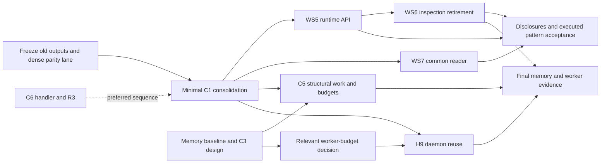

# v0.2.3 Macro Plan: Type 2 Review

2026-10-28. Reviewed the uncommitted draft on `v0.2.3`, its roadmap,
inventory A–F, RFC pipeline, decision bridge, accepted strategy synthesis and
v0.2.2 planning precedent. Dependency claims below were checked against the
current R implementation. This is a planning review, not a new execution or
performance result.

**Verdict: RESTRUCTURE.** The core-first direction is sound, including decision
A, but the draft mixes hard prerequisites, preferred sequencing and release
scope into one serial spine. Its identity checkpoint and two workstream joins
cannot stand as written.

## Findings, ranked by consequence

### F1 — Critical: Phase C cannot close the promised identity epoch

**Evidence:** draft §1.5, §2, WS10 and §7; inventory C11/C4/H10; strategy
synthesis D5/D7; `R/config-hash.R:1`, `:5`, `:65`;
`R/snapshots-hash.R:1`, `:92`; `R/availability-ingest.R:176`;
`R/store-gate.R:3`, `:158`, `:188`; `R/snapshot.R:123`.

The draft includes C11 in the coordinated bump but implements it in Phase D,
after the Phase C checkpoint. Precision can change normalized source prices
and snapshot hashes. Later execution-policy implementation changes results;
helper-bundle implementation can change strategy identity. Their designs have
not yet determined the exact identity/format changes. Phase C is not their
last writer.

There are also three different objects here: snapshot content identity,
run/session configuration identity, and the current-store fingerprint. The
fingerprint collects **all** `*_schema_version`/`*_rule_version` constants;
the store gate rejects a mismatch, including when opening snapshots. Thus a
rule-version change can require rebuilding a lake store even when its source
bar content did not change. Conversely, a new run configuration hash does not
automatically mean different source data. One global “identity bump” hides
which boundary each cut affects.

**Change:** record each cut's identity/format impact and refuse incompatible
artifacts when that cut lands. Do not defer necessary markers or add readers
to keep the old private lake usable. Use fresh development fixtures and defer
the expensive private rebuild until a named **final format/data freeze after
the last retained identity-changing cut**. One operational lake rebuild may be
achievable; one Phase C identity change is not established. Freeze the v0.2.2
reference separately so rebuilding the lake never rewrites the old oracle.
Plan how real-data work uses fresh scoped snapshots during that interval;
otherwise budget multiple rebuilds rather than promise one.

### F2 — High: WS5 → WS7 reverses part of WS5's acceptance dependency

**Evidence:** draft WS5, WS7 and §7; accepted strategy synthesis D8/D9 and
§4.6; `R/backtest-results.R:707`, `:715`, `:721`, `:878`.

WS5 is accepted only with run summary/print rounding disclosure and an executed
pattern article. WS7 is where the draft says those disclosures will land, but
it starts after WS5. Either WS5 is declared done before its accepted evidence,
or the disclosures first enter the old reader families and are merged later,
contrary to the draft's “land once” rationale.

The existing print already reads persisted results and composes valuation and
corporate-action summaries. It does not require a new strategy grammar to
consolidate those reads.

**Change:** after C1, run reader consolidation and API implementation as sibling
cuts, or do the structural reader merge first. Join them for rounding,
disclosure, article execution and WS5 acceptance. Keep one owner for the final
public reader contract; do not turn a preferred integration order into a
completed-API prerequisite.

### F3 — High: worker reuse is bundled ahead of its budget prerequisite

**Evidence:** draft WS4/WS9; inventory H9 explicitly depends on C1 **and C5**;
roadmap “Current planning release” makes structural memory and worker budgets
major outcomes. `R/walk-forward.R:546`, `:565` invokes a sweep per fold;
`R/sweep.R:218`, `:225` sets up workers and registers their stop.

Honoring the inventory creates `C5 → H9 inside WS4 → WS9/C5`. The draft avoids
that cycle only by omitting H9's budget dependency. Keeping daemons and staged
data alive across folds is a resource-lifetime change, not a condition for
removing the dense planner.

Memory is also left entirely behind WS6. Final memory acceptance should use
the final context, but baseline measurement and non-storage structural work
need not wait for it. The frame-retirement pipeline explicitly says those
views account for only 6–8% of R heap and retirement is not a memory lever.

**Change:** establish phase/worker baselines now; keep C3 design in parallel;
separate the minimal C1 consolidation gate from daemon reuse. Put the H9 cut
after the relevant C5 budget decision under its existing consolidation/
transport owner. Finalize memory evidence after context and other retained
allocation changes. Do not make a major release outcome the last optimization
attempt after the API is already accepted.

### F4 — High: the advertised critical path contains unsupported edges

**Evidence:** draft §2 and WS4; roadmap “One output handler”, “One result
reader” and “Peer benchmark suite”; the code and authorities in this table.

| Claimed edge | Disposition and evidence |
| --- | --- |
| WS1 → WS3 dense lane | **No hard dependency.** Durable benchmarking already calls public `ledgr_run()` (`dev/bench/peer_benchmark/peer_benchmark.R:397`, `:413`). The current sweep oracle uses the old memory handler at `:702`; adapting that caller after WS1 is maintenance, not a reason to delay freezing current outputs. Start the suite seed and freeze the dense baseline independently of WS1. |
| WS1 → WS4 | **Preferred sequence, not required by code or roadmap.** Both handlers are injected into the same `ledgr_execute_fold(execution, output_handler)` (`R/fold-engine.R:1573`; persistent caller `R/backtest-runner.R:1425`, memory caller `R/sweep.R:1880`). The roadmap explicitly calls output-handler consolidation independent. Keeping WS1 first reduces ownership conflict, but label that choice honestly. |
| WS3 dense lane → WS4 deletion | **Required accepted evidence dependency.** Roadmap peer-suite decision and inventory X4 explicitly require this oracle before dense removal. The seed can isolate that lane; installing/running every later peer/lane is not the deletion prerequisite. |
| WS4 → full WS5 runtime | **Keep under current constraints; see decision A below.** Dense freeze plus the global reader replacement makes this a real release-order constraint, although flat syntax alone does not require one engine. |
| WS5 → WS6 | **Keep the layout/implementation dependency.** The accepted synthesis D1/§7 and frame-retirement pipeline give WS6 that input. Its focused design can proceed now. The entire pattern article need not be finished before inspection integration work starts. |
| WS4 → WS7 | **Keep the accepted planning order.** The roadmap says merge readers after one run shape. Current reader branching confirms the reason (`R/availability-results.R:681`); it is not evidence for WS5 → WS7. |
| WS5 → WS7 | **Remove as a hard edge.** Use the integration join in F2. |
| WS1 + WS4 → WS8 | **Keep if WS8 is retained.** The roadmap expressly orders the typed P3–P5 batch after both and requires a whole-run/allocation gate. |
| WS6 → all WS9 work | **Too broad.** Final context-dependent memory figures wait; baseline, attribution, placement design and worker-budget work can start earlier (F3). |

Freeze the old native outputs before destructive changes, not merely after
the new handler has become the only implementation. Keep the real-data
reference and dense lane distinct: a daily real-data reference does not by
itself cover bars-only calendar, sparse/missing bars, terminal pulse, costs,
risk and supported timing boundaries. WS3's seed must name the deletion
witnesses before C1 is cut. Intraday-like geometry must not silently become a
first-class intraday semantics commitment (contracts “Standard Metrics”).

### F5 — High: “RFC in scope” has become automatic economics implementation

**Evidence:** draft WS10/Phase D; inventory C11, C12a, U2 routes; roadmap
“Cross-asset precision design”, “Affordability and execution policy” and
“Research UX completion”; accepted strategy synthesis D3/D4/D8 and §7.

The inputs require these focused designs in this release and execution policy
before the first CRAN release. They do not supply accepted designs or a blanket
implementation cut for fractional quantities, new fill allocation and portfolio
construction. The draft promises implementation “as its RFCs land” without
bounding the resulting work. That can reopen helper flooring, native outputs,
rounding disclosure and every teaching/parity example after Phase C is closed.

The inventory's X3 dependency on C12a/U2 is also stale. The accepted strategy
RFC deliberately separates quantity-target authoring from cash-shortfall fills
and separate-capital portfolio composition. Conversely, several U2 inputs—
omitted holdings, leavers and capital reservation—now have binding answers in
that synthesis. Repeating them as open portfolio-design choices double-counts
the work and risks reversing the new API.

**Change:** take up the three RFCs now and reconcile their ownership against
the accepted API. Precision is an input to any step-based scaling design;
fill policy is an input to execution-sensitive construction. Those are local
interfaces, not a reason to serialize all RFC writing or block WS5 on the
entire economics chain. Admit implementation only through a separately bounded
scope decision/cut. If retained here, settle its effect on helper granularity
and identity before declaring the API/disclosure freeze; test intentional
economic changes after consolidation equivalence has been established.

### F6 — Medium: late surface decisions increase the work the release later deletes

**Evidence:** draft WS11/WS12; inventory H4, C9/C10 and M5; roadmap “Core
boundary and sister packages”; RFC pipeline helper-bundle and documentation
rows; accepted strategy synthesis §6.

Putting the entire prove-or-retire pass after WS5/WS7 invites migration,
examples and contract repairs for surfaces H4 may retire. C10's census and
coupling measurement can begin now. Only its final decisions that depend on
the surviving API need the later join. Documentation debt must use the retained
surface, not a succession of temporary export inventories.

C9 also loses its explicit small Type 2/RFC mechanism decision in WS11's route.
It has three candidate mechanisms and a contract amendment; it is not just an
export-label chore. Resolve or explicitly assign that decision before its
implementation cut. R2 should open at the first cut as routed; it need not
block unrelated handler code, but it governs M5/M7 before they start.

M8a is independently repairable in `print.ledgr_run_list()`
(`R/run-store.R:916`, `:934`), outside the three named reader files. C12b is
also explicitly allowed earlier by the roadmap. Landing them on the merged
path is economical, not an intrinsic dependency on WS5.

### F7 — Medium: the proposed valves remove an explicit design commitment

**Evidence:** draft §6C; inventory “Maintainer decisions, 2026-10-27”, C3,
M5 and M2; roadmap memory and tiering commitments.

Moving WS8 is a reasonable first scope proposal. Moving the **C3 RFC** next is
not: the maintainer expressly took it up in v0.2.3, and it feeds a major memory
outcome. Keep placement design; defer unproven broad storage migration if the
design does not justify it. Any removal of C3 requires a new scope decision.

C10 and C9 are not one indivisible valve. Retain the boundary measurement and
needed retained-surface decisions; otherwise M5/H1 and final documentation can
be invalidated. C9's mechanism may move only if this is explicitly not the
first CRAN release and M5 still has a credible closure plan. The inventory
currently makes M5 depend on both; discharge that dependency rather than
declare all three complete independently.

## Input and coverage reconciliation

No whole Due RFC cycle is missing: release CI, docs roles, persisted placement,
precision, benchmark methodology, portfolio construction, helper bundles,
execution policy and frame retirement are all named. The accepted strategy
cycle has WS5. Most IDs are accounted for; the problems are ownership, stale
dependencies and what “implementation” promises.

| Inventory area | Required reconciliation |
| --- | --- |
| A: C1–C13 | Keep C6/R3, C1, C8 and the typed-batch order; fix C3's valve and C11's checkpoint. Distinguish C12a's design from C12b's existing-refusal disclosure. C13 remains an explicit proposed separate-packet decision. |
| B: U1–U4 | U1 is a current-tree reconciliation, not fresh implementation. Narrow U2 around the accepted API; U3 retains R4's identity/recovery/preflight obligations. Do not reopen completed U4 scheduling. |
| C: M1–M9 | M1/M5/H5b and the accepted plots/print work remain owed. M3 is handled by decision B. M6 is present in WS12's body despite its omitted heading ID; that is not a missing workstream. M4/M6 remain conditional on the eventual CRAN release. |
| D: H rows | H5a/H6/H11 are superseded/absorbed, not extra deliverables; H12/H13 are complete. Separate H9's budget dependency. H10 means exporting/restoring settlement-plan state to avoid rebuilding it, not merely “carry pending actions as data”: `R/walk-forward.R:1299` already rebuilds the plan and `:1329` returns plain pending columns; the historical owner is macro v0.2.2 “Corporate-action settlement state as data”. |
| E: R/D rows | Keep R3 on the first fill-event boundary edit and preserve R4 when U3 absorbs it. D1 remains conditional on objective-based selection; D2's Q16/Q18 belong to execution policy, with the rest routed to OMS. R1's inventory M2/chain-5 CRAN deadline conflicts with its own row/pipeline “next publication” deadline: explicitly choose the earlier publication gate as a planning decision rather than cite the inputs as identical. |
| F: X1–X4 | Keep X1 with H8; C4 shares its seeding path but is a separate versioned optimization. X2 is a reference-estimator input, not an optimizer catalogue. Update X3's obsolete C12a/U2 dependencies; separate X4's early deletion oracle from its later authoring/full-suite deliveries. |

## Recommended dispositions for A–C

### A — Adopt consolidation before the full runtime API; correct the rationale

The synthesis's “no new execution-mode branch” alone does not logically prove
C1 must come first: D1 even permits a private adapter. But dense is separately
frozen to fixes with no new features/branches (roadmap; v0.2.2 macro plan
“Execution-core consolidation”). A complete replacement API cannot leave dense
on a parallel legacy public grammar.

This is concrete code work, not just a function rename. The fold constructs a
history reader only for availability (`R/fold-engine.R:1639`), retains dense
static views (`:1689`) and dense fast-context preparation (`:1775`), and chooses
different context helpers at `:778`. The dense fast helper mutates its pulse
cursor (`R/pulse-context.R:583`); a kept lazy view must freeze its own values.
Dense has a lot book (`R/fold-engine.R:1594`), so FIFO arithmetic is not the
blocker. Dense would still need the new named immutable view, calendar/fact
provenance, declared state and its frozen missing-price behavior preserved.

Therefore retain C1 → full WS5 under the accepted constraints. Let schema,
selection/type work, the spec cut and article drafts proceed earlier. Split
C1's minimal consolidation gate from transport/worker and other optional
co-travellers under their existing owners; do not reopen dense to deliver the
headline earlier.

### B — Accept with explicit ownership and trigger conditions

Keep M3's path; retain per-block H4 decisions; put public crypto in its own
packet after its core/precision prerequisites. Absorb R4 into U3 without
erasing its proof obligations. Defer H7 telemetry redesign without deferring
current memory/performance measurement. Keep D1 deferred only while its
objective-selection trigger remains absent; an H4 workflow that fires it must
take ownership. Re-defer the remaining OMS work while explicitly assigning
Q16/Q18 and the consume/re-defer decisions to execution policy.

### C — Revise the order and narrow the release

**As written, this is too much to promise as one bounded version:** three large
consolidations, a new state/fact/API lifecycle, structural memory work, a
multi-engine suite, nine Due design cycles, economics implementation, surface
retirement and explicit maintenance debt. This is an integration-risk judgment;
the draft supplies no effort estimates from which to make a duration claim.

Recommended scope-pressure order, requiring maintainer approval where it
changes the current roadmap:

1. Move WS8's optional typed execution batch after v0.2.3, preserving its
   measurements and owner. Do not move the required structural memory outcome.
2. Remove automatic enrollment of all WS10 RFC outcomes into this release.
   Complete the required designs here; put broad precision/fill-policy/
   construction implementation in a bounded follow-up before the first CRAN
   release unless explicitly retained. Keep existing-refusal disclosure now.
3. If v0.2.3 is not the CRAN release, condition the tiering mechanism and
   publication-only CRAN chores accordingly. Retain C10's useful scope
   decisions and show how mandatory documentation debt closes. Keep C3's RFC.

Do not silently shrink the maintainer's new peer-suite commitment to one lane
or drop the plots/debt. Parallelize them and seek an explicit scope amendment
if they cannot fit. A later version below 0.3.0 is available for the separate
economics/CRAN outcome; no accepted source requires v0.2.3 itself to be CRAN.

## Recommended dependency skeleton

RNG correctness, scope audits, the other RFCs and required debt proceed beside
this graph. Final economics decisions, retained identity-changing cuts,
teaching, suite evidence and memory acceptance join before the actual release
freeze/private rebuild and publication. `tickets.yml` still sequences each
accepted cut. The draft plan was not edited; no commit was made.
