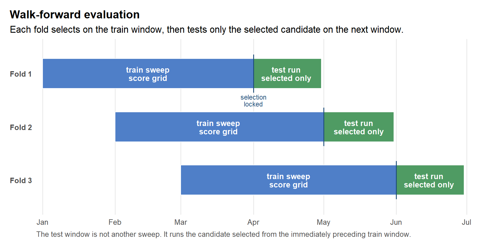

# Walk-Forward Evaluation


You ran a sweep and picked the best candidate. Was that a real edge, or
the luckiest parameter on this slice of history? A sweep selects and
scores on the same data, so its winner is in-sample evidence. It cannot
tell you whether the rule generalizes.

Walk-forward evaluation puts a selection rule to a rolling, held-out
test. Held-out folds are dependent evidence about the selection rule:
they share the snapshot, the grid and your choices, so a good
walk-forward result does not prove that the rule generalizes. It splits
time into folds, and in each one it selects a candidate on a train
window, then tests only that candidate on the next, untouched window.
The test window is held-out evidence: the selection never saw it.

``` text
for each fold:
  train snapshot window -> sweep candidates -> scalar selection
  selected candidate -> test window run -> recorded evidence
```

Walk-forward uses the same `ledgr_sweep()` and `ledgr_run()` machinery
as the rest of ledgr; it does not add a separate execution engine. By
the end of this article you will run a multi-fold evaluation, read its
train-versus-test degradation table, and extract a candidate for review.

## Setup

``` r
library(ledgr)
library(dplyr)

data("ledgr_demo_bars", package = "ledgr")
```

> [!NOTE]
>
> ### Running this yourself
>
> The code writes to a temporary DuckDB store, so the article leaves no
> project files behind. The demo-data window and fold sizes are kept small
> so the vignette runs quickly; they are not a statistical recommendation.


``` r
bars <- ledgr_demo_bars |>
  filter(
    instrument_id %in% c("DEMO_01", "DEMO_02"),
    between(ts_utc, ledgr_utc("2019-01-01"), ledgr_utc("2019-12-31"))
  )

snapshot <- ledgr_snapshot_from_df(
  bars,
  db_path = tempfile(fileext = ".duckdb"),
  snapshot_id = "walk_forward_demo"
)
```

The experiment is the same kind of object used by `ledgr_run()` and
`ledgr_sweep()`. Its strategy is `ledgr_demo_sma_crossover_strategy()`,
which holds `qty` shares of an instrument while its fast moving average
over `fast_n` bars is more than `threshold` above its slow average over
`slow_n` bars, and nothing otherwise.

``` r
features <- ledgr_feature_map(
  fast = ledgr_ind_sma(ledgr_param("fast_n")),
  slow = ledgr_ind_sma(ledgr_param("slow_n"))
)

exp <- ledgr_experiment(
  snapshot = snapshot,
  strategy = ledgr_demo_sma_crossover_strategy(),
  features = features,
  opening = ledgr_opening(cash = 10000),
  cost_model = ledgr_cost_zero()
)
```

## Folds And The Train/Test Boundary

Folds are calendar-time value objects. They describe train and test
scoring windows; they do not execute anything by themselves.

``` r
folds <- ledgr_folds_rolling(
  start = "2019-01-01",
  end = "2019-07-31",
  train_window = "3 months",
  test_window = "1 month",
  step = "1 month"
)

folds
#> ledgr fold list
#> ================
#> Scheme: rolling
#> Folds:  3
#> Hash:   2fc89449a420
#>
#> # A tibble: 3 x 3
#>    fold train                    test
#>   <int> <chr>                    <chr>
#> 1     1 2019-01-01 -> 2019-03-31 2019-04-01 -> 2019-04-30
#> 2     2 2019-02-01 -> 2019-04-30 2019-05-01 -> 2019-05-31
#> 3     3 2019-03-01 -> 2019-05-31 2019-06-01 -> 2019-06-30
```

Each window also starts its features fresh. A train or test window never
reads bars from before its own start, so every indicator warms up again
inside every window: the 20-session slow moving average used below is
missing for the first 19 sessions of each train and test window, and the
strategy cannot cross into a position until it exists. Size windows so
that warmup is a small part of each one: if no candidate trades in a
train window, the Sharpe ratio used for selection has no finite value
and that fold has no selection. By default (`no_selection = "previous"`)
the fold then runs its test window with the candidate most recently
selected from training, or runs no test window if training has not
selected anything yet; each fold’s `selection_source` says which, and
the printed session counts them. `no_selection = "fail"` stops the
session with `ledgr_walk_forward_no_selection` instead. This restart
concerns features only; the opening-state policy described later
concerns positions. Hydrating features from earlier history is planned
with ledgr’s point-in-time history design.

Plotting the folds makes the core contract easier to see. The blue train
window sweeps and scores the grid. At the boundary, ledgr locks one
selected candidate. The green test window then runs only that candidate.



## Build The Grid And Run It

Build a small grid. Feature parameters vary the concrete SMA windows.
Strategy parameters vary the target quantity and threshold.

``` r
feature_grid <- ledgr_feature_grid(
  fast_n = c(5L, 10L),
  slow_n = 20L,
  .filter = fast_n < slow_n
)

strategy_grid <- ledgr_strategy_grid(
  qty = 5,
  threshold = 0
)

grid <- ledgr_grid_cross(features = feature_grid, strategy = strategy_grid)
```

The selection rule is explicit and scalar: ledgr selects one candidate
per fold from the train-window score rows.

``` r
wf <- ledgr_walk_forward(
  exp,
  grid = grid,
  folds = folds,
  selection_rule = ledgr_rule_argmax("sharpe_ratio"),
  seed = 2026L
)

wf
#> ledgr walk-forward
#> ==================
#> Fold selections: 3 from training, 0 reused from an earlier fold, 0 without a candidate.
#> Health warning: one or more test windows are shorter than 90 calendar days.
#>
#> Train/test degradation:
#> # A tibble: 3 x 7
#>   fold_seq selection_metric train_metric_value test_metric_value metric_diff_abs
#>      <int> <chr>                         <dbl>             <dbl>           <dbl>
#> 1        1 sharpe_ratio                   1.98             0.800           -1.18
#> 2        2 sharpe_ratio                   1.62            -4.47            -6.09
#> 3        3 sharpe_ratio                   1.79             3.64             1.85
#> # i 2 more variables: warning_flags <chr>, selected_candidate <chr>
#>
#> Session: d437ccc9af097caeae8515bcd61afe892c145336555ed27eff078cd75dfb6477
#> Status: DONE
#> Opening state: carry_test_state
#> Folds: 3
#> 6 train evaluations attempted: 6 done, 0 incomplete, 0 failed.
#> 3 test runs attempted: 3 done, 0 incomplete, 0 failed.
```

## Read The Degradation Table First

The degradation table is the first surface to inspect. Printing it shows
the core train-versus-test columns; the full table, including the window
ranges and percentage change, is one `as_tibble()` away.

``` r
wf$degradation
#> # ledgr walk-forward degradation
#> # A tibble: 3 x 7
#>   fold_seq selection_metric train_metric_value test_metric_value metric_diff_abs
#>      <int> <chr>                         <dbl>             <dbl>           <dbl>
#> 1        1 sharpe_ratio                   1.98             0.800           -1.18
#> 2        2 sharpe_ratio                   1.62            -4.47            -6.09
#> 3        3 sharpe_ratio                   1.79             3.64             1.85
#> # i 2 more variables: warning_flags <chr>, selected_candidate <chr>
#>
#> # i Hidden columns: train_window, test_window, metric_diff_pct, selection_source. Use as_tibble() for the full table.
```

`metric_diff_abs` is `test_metric_value - train_metric_value`. Whether a
positive value means improvement or degradation depends on the selection
rule direction.

Short test windows may carry warning flags. Those warnings are not
failures; they are metadata telling you how to interpret the evidence.
Here each test window is one month of two demo instruments, so the
annualized Sharpe ratios swing from -4.47 to 3.64 between folds; at this
size they show the shape of the evidence, not its strength.

## Extract A Candidate With A Rationale

Use `ledgr_candidate()` to extract the selected candidate for a specific
fold. Using `"latest"` is allowed only with a rationale.

``` r
candidate <- ledgr_candidate(
  wf,
  fold_seq = "latest",
  selection_rationale = "Documentation example: inspect the latest completed fold."
)

candidate
#> ledgr_sweep_candidate
#> =====================
#> Strategy params:  {"qty":5.0,"threshold":0.0}
#> Feature params:   {"fast_n":10,"slow_n":20}
#> Candidate ID:     feature_af0f94c90243/strategy_86be010cf688
#> Status:           DONE
#> Execution seed:   1624473114
#> Strategy:         7a84341722d5
#> Snapshot hash:    7541f794ddcc0be54533f510a911e15af92c60c365957d2ff069d7ceb81685a4
#> Feature-set hash: f7026cd02411bdc7b52beab150390fc3facb90a9dd7c5c0b419ac4ddee22ee69
#> Evaluation scope: walk_forward
str(candidate$feature_params)
#> List of 2
#>  $ fast_n: int 10
#>  $ slow_n: int 20
```

The print shows the strategy parameters. The feature parameters, the
moving average lengths behind the `feature_...` part of the ID, are in
`candidate$feature_params`.

Promotion uses the same candidate object as sweep promotion. In a real
research project, promote only after you have written down why this fold
and candidate are being reviewed.

``` r
promoted <- ledgr_promote(
  exp,
  candidate,
  run_id = "wf_latest_review",
  note = "Manual review accepted the latest completed fold."
)

promoted
#> ledgr Backtest Results
#> ======================
#>
#> Run ID:                            wf_latest_review
#> Period:                            2019-01-01 to 2019-12-31
#> Opening Cash:                      $10000.00
#> Final Equity:                      $10187.68
#> Total Return:                      1.88%
#> Max Drawdown:                      -0.79%
#> Closed Trades:                     10
#> Metric Calendar:                   US equity daily (default) (252 days/year * 1 bars/day = 252 bars/year)
#>
#> Economic events: NOT SUPPLIED - returns may omit distributions
#> Price basis: UNDECLARED - distribution double counting cannot be ruled out
#>
#> Use summary(bt) for metrics and evidence
```

This executes safely because the article uses a temporary store. It
records the chosen fold and rationale; it does not turn the fold into
fresh validation.

## Reading The Evidence Honestly

A degradation table is easy to over-read. Three things bound what it can
tell you.

Walk-forward evidence is only as survivorship-safe as the sealed
snapshot and universe semantics it evaluates: a snapshot of today’s
survivors hides the instruments that failed along the way, as
`vignette("survivorship-bias", package = "ledgr")` shows.

> [!WARNING]
>
> ### Selection integrity is a separate question
>
> Reproducibility and selection integrity are orthogonal. Walk-forward
> records what was selected and tested; it does not prove that the search
> space, metric, or selection procedure was statistically sound. Scalar
> scores are not PBO, CSCV, CPCV, DSR, benchmark diagnostics, or a
> multiple-testing correction. ledgr ships PBO/CSCV, MinTRL, K-Ratio, DSR,
> and effective-trial diagnostics as separate evidence surfaces; see
> `vignette("selection-integrity", package = "ledgr")`. For what
> provenance does and does not prove, see
> `vignette("reproducibility", package = "ledgr")`.


> [!WARNING]
>
> ### Test folds are not independent
>
> The default `opening_state_policy = "carry_test_state"` is
> path-dependent. Each completed selected test run may seed the next test
> opening state, so per-fold test metrics are not independent
> observations. Carrying needs test windows that follow each other and
> touch exactly, which is why the folds above step by one month, the
> length of their test window. With a larger `step`, positions would cross
> the trading days between two test windows without ever being valued;
> with a smaller one, the windows overlap and a test run would start from
> positions its predecessor only reached later. `ledgr_walk_forward()`
> refuses both before running anything and names the first offending pair.
> The explicit `opening_state_policy = "flat_test_state"` opt-in starts
> every test window from the original experiment opening state, accepts
> any fold layout, and marks the result as `cold_start_distorted`.


Anchored folds grow their train window over time. That is useful for
some research workflows, but later folds can cost more to compute than
early folds, especially with large candidate grids and wide feature
sets.

## Try It

> [!TIP]
>
> ### Try it
>
> Re-run `ledgr_walk_forward()` with
> `opening_state_policy = "flat_test_state"`. How does the degradation
> table change, and why does `cold_start_distorted` appear? Then widen
> both `test_window` and `step` in `ledgr_folds_rolling()` to `"2 months"`
> and re-run. The short-test-window flags stay, because the health check
> asks for at least 90 calendar days. How long must a test window be
> before they go away, and how many folds still fit between `start` and
> `end`?


## What This Does Not Do

> [!IMPORTANT]
>
> ### Outside this surface
>
> ledgr does not yet implement paper/live walk-forward, OMS behavior,
> cross-snapshot walk-forward, benchmark-relative metrics, gross-vs-net
> attribution, signal decay, implementation/cost decay, or per-fold
> selection-integrity diagnostics. Those require later surfaces over the
> stable session and candidate identity introduced here.


## Where Next

- To read windows of past values inside a strategy, continue with
  `vignette("causal-history", package = "ledgr")`. If your research
  needs calendars, changing universes, trading restrictions, or
  corporate actions,
  `vignette("point-in-time-inputs", package = "ledgr")` follows it; a
  study on complete daily bars can go on to
  `vignette("strategy-authoring-tools", package = "ledgr")`.
- For the sweep, selection and promotion loop this builds on, see
  `vignette("sweeps", package = "ledgr")`.
- For the Sharpe ratio and annualization conventions behind these
  scores, see
  `vignette("metric-contexts-and-conventions", package = "ledgr")`.
